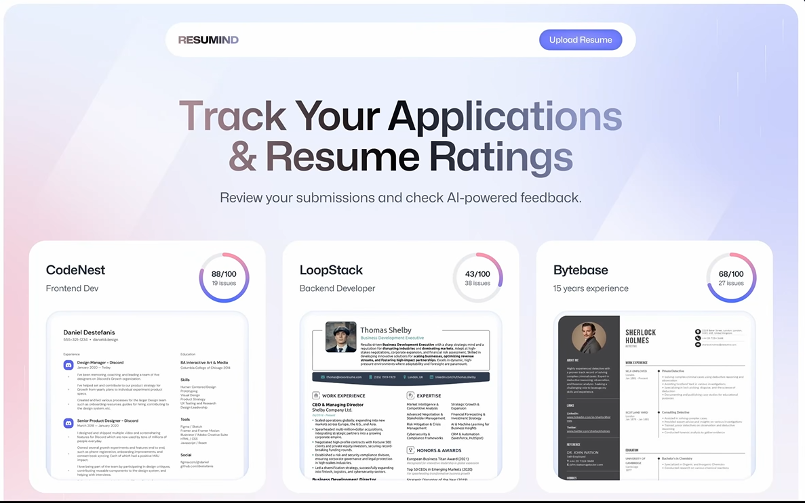

# AI-Powered Applicant Tracking System (Resumind)

An AI-powered resume analyzer. Upload your resume as a PDF, paste the job you're applying for, and get an ATS (Applicant Tracking System) score along with detailed, actionable feedback — all without running your own backend.

Built with **React Router v8**, **React 19**, **TypeScript**, **Tailwind CSS v4**, and **[Puter.js](https://developer.puter.com/)** for authentication, file storage, key-value storage, and AI.



## Features

- **Resume upload** — drag & drop a PDF (max 20 MB) with `react-dropzone`
- **Job-aware analysis** — enter company name, job title, and job description so feedback is tailored to the role
- **ATS score** — an overall score out of 100 plus an ATS-compatibility score with specific tips
- **Category breakdown** — separate scores and tips for *Tone & Style*, *Content*, *Structure*, and *Skills*
- **Resume dashboard** — every analyzed resume is saved and shown as a card with its score and a preview image
- **Detailed review page** — side-by-side resume preview and expandable feedback sections
- **User accounts** — sign in with Puter; your resumes and results are stored in your own Puter account
- **Server-side rendering**, **Docker support**, and a fully typed codebase

## How It Works

1. You sign in through Puter (`/auth`).
2. On `/upload`, you provide the company, job title, job description, and a PDF resume.
3. The PDF is uploaded to Puter cloud storage, and its **first page** is rendered to a PNG in the browser using `pdfjs-dist` (used for previews).
4. The PDF and a structured prompt (job title, job description, and the expected JSON schema) are sent to Claude through `puter.ai.chat`.
5. The model returns feedback as JSON, which is saved in Puter's key-value store under `resume:<uuid>`.
6. You're redirected to `/resume/:id` to view the full report; the home page lists all saved results.

## Tech Stack

| Area | Technology |
| --- | --- |
| Framework | React Router v8 (framework mode, SSR) |
| UI | React 19, Tailwind CSS v4, `tw-animate-css`, `clsx`, `tailwind-merge` |
| Language | TypeScript 5 |
| Build tool | Vite 8 |
| State | Zustand |
| PDF handling | `pdfjs-dist`, `react-dropzone` |
| Backend services | Puter.js (auth, file system, key-value store, AI) |
| Deployment | Docker (Node 24 Alpine) |

## Project Structure

```
.
├── app/
│   ├── components/        # ATS, Accordion, Details, FileUploader, Navbar,
│   │                      # ResumeCard, ScoreBadge, ScoreCircle, ScoreGauge, Summary
│   ├── lib/
│   │   ├── puter.ts       # Zustand store wrapping Puter auth / fs / ai / kv
│   │   ├── pdf2img.ts     # PDF (first page) → PNG conversion
│   │   └── utils.ts       # Helpers (cn, formatSize, generateUUID)
│   ├── routes/
│   │   ├── home.tsx       # Dashboard of saved resumes
│   │   ├── auth.tsx       # Log in / log out
│   │   ├── upload.tsx     # Upload form + analysis pipeline
│   │   ├── resume.tsx     # Detailed feedback for one resume
│   │   ├── wipe.tsx       # Developer utility: delete all app data
│   │   └── constants/     # AI prompt + response format, shared types
│   ├── root.tsx           # Layout, fonts, Puter.js script
│   ├── routes.ts          # Route configuration
│   └── app.css            # Tailwind and custom styles
├── public/                # Icons, images, PDF.js worker
├── Dockerfile
├── react-router.config.ts
├── vite.config.ts
└── package.json
```

## Routes

| Path | Description |
| --- | --- |
| `/` | Dashboard with all analyzed resumes |
| `/auth` | Sign in / sign out with Puter |
| `/upload` | Upload a resume and request an analysis |
| `/resume/:id` | Full feedback report for a resume |
| `/wipe` | Deletes all files and stored data for the signed-in user (development use) |

## Getting Started

### Prerequisites

- **Node.js 20+** (the Docker image uses Node 24)
- **npm**
- A free [Puter](https://puter.com) account (you'll be prompted to sign in when you open the app)

No `.env` file or API keys are required — AI, storage, and authentication are all provided by Puter.js, which is loaded from `https://js.puter.com/v2/`.

### Installation

```bash
git clone https://github.com/BOLT2006/AI-Powered-Applicant-Tracking-System.git
cd AI-Powered-Applicant-Tracking-System
npm install
```

### Development

```bash
npm run dev
```

Open [http://localhost:5173](http://localhost:5173). Log in with Puter when prompted, then upload a resume.

### Production Build

```bash
npm run build
npm run start
```

The server runs the output in `build/` (`build/client` for static assets and `build/server` for server code).

### Type Checking

```bash
npm run typecheck
```

## Available Scripts

| Script | Description |
| --- | --- |
| `npm run dev` | Start the dev server with HMR |
| `npm run build` | Create a production build |
| `npm run start` | Serve the production build |
| `npm run typecheck` | Generate route types and run `tsc` |

## Docker

```bash
docker build -t ai-ats .
docker run -p 3000:3000 ai-ats
```

Then open [http://localhost:3000](http://localhost:3000). The multi-stage image installs dependencies, builds the app, and ships only production dependencies and the `build/` output.

The container can be deployed to any Docker-compatible platform (AWS ECS, Google Cloud Run, Azure Container Apps, Fly.io, Railway, etc.).

## Score Interpretation

| Score | Meaning |
| --- | --- |
| 70+ | Strong |
| 50–69 | Good start |
| Below 50 | Needs improvement |

## Data & Privacy

- Resumes, preview images, and analysis results are stored in **your own Puter account** (file system + key-value store), not on a server run by this project.
- Resume content is sent to an AI model through Puter for analysis.
- Use the `/wipe` page to delete all stored files and data for your account.

## Known Limitations

- Only the **first page** of the PDF is converted to a preview image.
- Only **PDF** files up to **20 MB** are supported.
- AI feedback is a guide, not a guarantee of how any specific employer's ATS will rate a resume.
- The `/wipe` route has no confirmation prompt — use it carefully.

## Roadmap

- [ ] Multi-page resume previews
- [ ] Delete individual resumes from the dashboard
- [ ] Compare multiple versions of a resume
- [ ] Export feedback as PDF

## Contributing

Contributions, issues, and feature requests are welcome. Feel free to open an issue or submit a pull request.

## License

Add a license file (for example, MIT) and update this section.

## Acknowledgements

- [React Router](https://reactrouter.com/)
- [Puter.js](https://developer.puter.com/)
- [PDF.js](https://mozilla.github.io/pdf.js/)
- [Tailwind CSS](https://tailwindcss.com/)